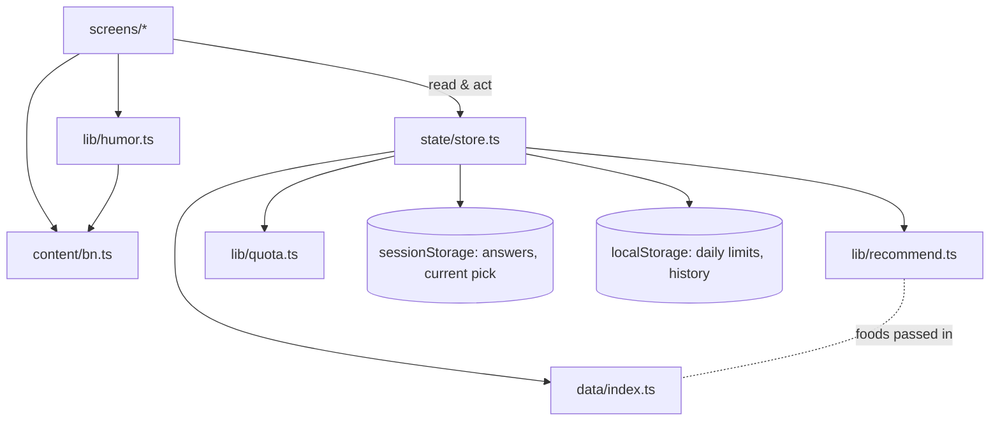

# Architecture

**কি খাবো?** is a static, installable web app (PWA): Vite + React + TypeScript + Tailwind CSS, hosted free on Vercel, with no backend. Everything runs in the browser. Why each choice was made is in [decisions/](decisions/). Product rules are in [brief.md](brief.md).

## Tech stack

| Layer | Choice |
| --- | --- |
| Build / dev server | Vite 8 |
| UI | React 19 + TypeScript |
| Routing | React Router 8 (component routes, `BrowserRouter`) |
| Styling | Tailwind CSS v4; design tokens in `src/index.css` `@theme` |
| Animation | Motion (`motion/react`) via `LazyMotion`; reduced motion honored globally |
| Fonts | Hind Siliguri + Noto Sans Bengali, self-hosted with `@fontsource` |
| Share image | `html-to-image` (loaded only on the share screen) |
| Installable app | `vite-plugin-pwa` (manifest, icons, offline service worker) |
| Tests | Vitest |
| Lint | oxlint |
| Hosting | Vercel (static), `vercel.json` SPA rewrite |

## How it fits together



- **Screens** render one thing each and call actions on the store.
- **`state/store.ts`** holds all app state. Quiz answers and the current pick live in `sessionStorage` (cleared when the tab closes). Daily limits, recent dishes and accepted dishes live in `localStorage`.
- **`lib/recommend.ts`** is the pure engine. Foods, answers and randomness are passed in, so it's fully unit-tested.
- **`lib/humor.ts`** picks funny copy *after* the engine has chosen a dish, using a stored seed so the copy stays the same on re-render.
- **`lib/quota.ts`** handles pure daily-limit logic (3 suggestions, 3 spins, reset at local midnight).

## Recommendation engine

See [features/recommendation-engine.md](features/recommendation-engine.md). In short:

1. **Hard rules:** diet, restricted ingredients and rejected dishes. Never relaxed.
2. **Soft filters:** meal time (dropped if fewer than 3 dishes remain) and budget (falls back to the 3 cheapest dishes).
3. **Diversity:** skip dishes shown this visit and the last 5 on this device, while others remain.
4. **Score:** `0.35·Mood + 0.25·Budget + 0.20·Time + 0.20·Preference`.
5. **Weighted random** among the top 5.

Gender and age are never inputs to steps 1–5.

## Routes

| Path | Screen | Needs |
| --- | --- | --- |
| `/` | Landing | — |
| `/step/gender` → `/step/age` → `/step/mood` → `/step/meal` → `/step/budget` | Quiz, one question per screen | every earlier answer (otherwise redirects) |
| `/loading` | Funny loading messages, then picks a dish | all answers |
| `/result` | Result, limits, final decision | a current pick (otherwise a "nothing found" screen) |
| `/roulette` | Food wheel (3 spins/day) | — |
| `/battle` | Food battle with a fun poll | — |
| `/share` | Meme card: PNG, share, WhatsApp, Facebook | — |
| `*` | Not found | — |

## Folder structure

```
ki-khabo/
├── index.html            # lang="bn", meta, icons
├── vite.config.ts        # React, Tailwind, PWA, "@" alias, Vitest
├── vercel.json           # SPA rewrite
├── public/               # favicon.svg, icons/, robots.txt
└── src/
    ├── main.tsx          # fonts + CSS + <App/>
    ├── App.tsx           # router, lazy screens, frame, screen-in animation
    ├── index.css         # Tailwind + design tokens (@theme), ink-outline / chunky utilities
    ├── content/bn.ts     # ALL Bengali UI copy (roasts, loading lines, captions…)
    ├── data/             # foods.ts, options.ts, battles.ts, index.ts (+ data.test.ts)
    ├── lib/              # recommend, humor, quota, rng, meal-time, bn-number, share, storage (+ tests)
    ├── state/            # store.ts (state + actions), app-state.tsx (provider)
    ├── components/       # Button, OptionCard, OptionGroup, Chip, Sticker, ProgressBar, Mascot,
    │                     # FoodCard/FoodVisual, Confetti, Heading, StepLayout
    └── screens/          # Landing, Step*, Loading, Result, Roulette, Battle, ShareCard, NotFound
```

## Design tokens

From [the design system](ajke_ki_khabo_design_system.html), in `src/index.css`:

| Token | Value | Tailwind |
| --- | --- | --- |
| cream / ink / muted | `#FFF8EC` / `#2B1B0E` / `#7A5A3E` | `bg-cream`, `text-ink`, `text-muted` |
| masala / haldi / morich / dhonepata / peach | `#FF7A1A` / `#FFC93C` / `#E8443A` / `#2FA36B` / `#FFE7C7` | `bg-masala` … |
| morich-dark / dhonepata-dark | `#C0312A` / `#1F7A4D` | used for white-on-red and green/red text (contrast) |
| radius | chip 10 · btn 14 · option 16 · result 20 · frame 22 · meme 24 | `rounded-chip` … |
| outline | 2px ink | `ink-outline` |
| chunky button | 2px ink, 5px bottom, sinks 3px on press | `chunky` |
| motion | wobble 1.2s, pulse 1.6s, confetti fall | `animate-wobble` … (wrap in `motion-safe:`) |

## Accessibility rules

- Text contrast meets WCAG AA. Ink text goes on masala, haldi and dhonepata; white text only on `morich-dark`.
- Every tappable element is at least 48px (`min-h-12`).
- Quiz answers are `<button aria-pressed>` inside labelled groups, and errors use `role="alert"`.
- After navigation, focus moves to the new screen's `<h1>` (`components/Heading.tsx`).
- Decorative emoji are `aria-hidden`; food emoji have `role="img"` with the dish name.
- Animations respect prefers-reduced-motion. The wheel lands instantly and confetti is skipped.

## Rules to keep in mind

- **Copy goes in `src/content/bn.ts`.** Option labels live with their ids in `src/data/options.ts`.
- **Follow the humor rule** (brief): joke about the situation, never the person.
- **Keep `lib/recommend.ts`, `lib/quota.ts` and `lib/humor.ts` pure**: no `window`, no React.
- **Never ship a dish without `contains`.** When unsure, list the ingredient.
- **Don't rename food ids.** Saved history refers to them.

## Commands

```bash
npm install
npm run dev       # http://localhost:5173
npm test          # Vitest
npm run lint      # oxlint
npm run build     # type-check + production build into dist/
npm run preview   # serve dist/ at http://localhost:4173
```
